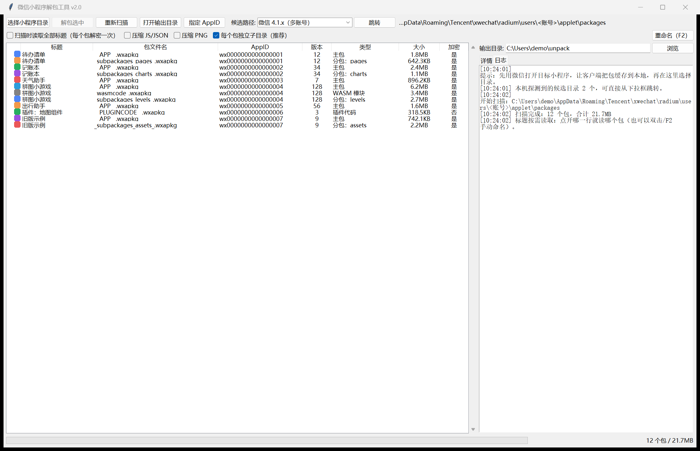

# wxapkg-gui

> **免责声明**：此工具仅限于学习和研究软件内含的设计思想和原理，用户承担因使用此工具而导致的所有法律和相关责任！作者不承担任何法律责任！

微信小程序 `.wxapkg` 扫描 / 解密 / 解包工具，Python + tkinter 实现，同时提供图形界面与命令行。基于 [wux1an/wxapkg](https://github.com/wux1an/wxapkg) 的思路重写，**适配微信 PC 端 3.x / 4.0 / 4.1.x**。

## 微信各版本缓存路径（实测）

| 微信版本 | 小程序包目录 |
| --- | --- |
| 3.x | `~/Documents/WeChat Files/Applet/<AppID>/<版本号>/` |
| 4.0 | `%APPDATA%/Tencent/xwechat/radium/Applet/packages/<AppID>/<版本号>/` |
| 4.1.x | `%APPDATA%/Tencent/xwechat/radium/users/<账号>/applet/packages/<AppID>/<版本号>/` |

4.1.x 比 4.0 多一层 `users/<账号>`。本工具**不猜目录结构**：选定任意一层后递归找 `.wxapkg`，AppID 与版本号从路径里提取，所以三层布局都能直接吃。

## 界面截图



## 功能

- 手动指定目录（可选到 `packages` / `<AppID>` / `<版本号>` 任意一层），内置候选路径下拉框一键跳转
- **列表显示图标 + 小程序名称**，一眼认出目标（标题按需读取，不遍历所有包，见下节）
- 双击列表行或按 `F2` 可手动命名，写进 `wxid.json` 永久生效
- 自动识别 `V1MMWX` 加密包并调用 AES 解密；明文包（`0xBE` 开头）直接透传，不重复解密
- 一次列出主包、分包、插件代码、WASM 模块，显示加密状态、版本、大小
- 多选批量解包，每个包独立子目录，互不覆盖
- 路径识别不到 AppID 时可手动指定（解密必须用 AppID 派生密钥）
- 可选：JS/JSON 压缩、PNG 压缩
- 命令行子命令 `scan` / `unpack`，可用于脚本批处理
- `build_exe.bat` 一键打成两个 exe（界面版 + 命令行版）

## 标题从哪来（调研结论）

包里的 `app-config.json` / `game.json` / `app.json` **都不含小程序名称**，页面 json 里也没有 `navigationBarTitleText`。三处实测：

| 来源 | 结果 | 覆盖率（本机） |
| --- | --- | --- |
| `project.private.config.json` / `project.config.json` 的 `projectname` | 唯一带名字的地方，常是 URL 编码（`%E4%BF%9D...`），`minigame-` 之类前缀会去掉 | 7/27 个包，过滤脚手架默认名后有效 4 个 |
| `applet/icon/<AppID>_<hash>.png` 图标 | 微信缓存的小程序头像，缩成 20px 显示在列表首列 | 12/14 个主包 |
| 手动命名（`F2`） | 读不到名字时自己起一个，存 `wxid.json` | 100%，一次设置永久有效 |

**为什么不做联网查询**：开源工具几乎共用同一个接口 `kainy.cn/api/weapp/info/`，实测已返回 **403**（换 json/form body、加 Referer/Origin/Accept 都是 403，官方文档页也 404），接口已下线。工信部备案查询（ICP_Query）只能按名称反查、需过验证码且要自建服务；微信开放平台接口需要 access_token；微信自己的 `applet/data/8/applet.db` 是 SQLCipher 加密的（社区定向逆向 4.1.x 也未拿到密钥）。所以没有免授权、稳定、免费的 appid→名称 公开接口。

**为了不"遍历"，标题是懒加载的**：扫描时只做一次 `listdir` 取图标（几乎零成本），标题在你点开某一行时才读那一个包（<0.1s），读过就缓存。想一次全读，勾选「扫描时读取全部标题」——实测 14 个 AppID 也只要 0.5 秒。

> 缓存位置：源码运行时是项目目录下的 `wxid.json`；打包成 exe 后写到 `%LOCALAPPDATA%\wxapkg_gui\wxid.json`，避免 exe 放在 `Program Files` 这类不可写目录时缓存失效。

## 快速开始（图形界面）

1. 用 PC 版微信打开目标小程序，让客户端把包下载到本地（包不在缓存里，任何工具都扫不到）
2. 运行 `python wxapkg_gui.py`
3. 点「选择小程序目录」，选到小程序缓存目录；或用「候选路径」下拉框 →「跳转」
4. 列表中多选要解包的包（`Ctrl`/`Shift` 多选）
5. 确认「输出目录」，点「解包选中」
6. 完成后可直接「打开输出目录」

默认勾选「每个包独立子目录」，输出结构：

```
<输出目录>/<AppID>/<版本号>/<包名>/
    例：unpack/wx2d9c229f4a12b409/7/__APP__/game.js
```

取消勾选则所有文件平铺到输出目录（多包会互相覆盖，仅在只解一个包时建议使用）。

## 命令行

```bash
# 扫描本机所有候选目录（3.x / 4.0 / 4.1.x）
python wxapkg_gui.py scan

# 扫描指定目录，仍输出 JSON 便于脚本处理
python wxapkg_gui.py scan "C:\Users\me\AppData\Roaming\Tencent\xwechat\radium\users\<账号>\applet\packages" --json

# 扫描时顺便读包内标题（每个 AppID 解密一次，14 个约 0.5 秒）
python wxapkg_gui.py scan "…\packages" --title

# 解包整个目录（递归，每个包独立子目录）
python wxapkg_gui.py unpack "<缓存目录>" -o out

# 只解一个包
python wxapkg_gui.py unpack "…/__APP__.wxapkg" -o out

# 路径里认不出 AppID 时手动指定
python wxapkg_gui.py unpack "<目录>" --appid wx1234567890abcdef

# 平铺输出 / 顺带压缩
python wxapkg_gui.py unpack "<目录>" -o out --flat --compress --compress-png
```

`unpack` 参数：`-o/--output`、`--appid`、`--no-decrypt`、`--flat`、`--compress`、`--compress-png`。
不带任何参数运行即启动图形界面。

## 解密原理

PC 端小程序包是加密的，头部为 `V1MMWX`：

```
密文 = b"V1MMWX" + AES-256-CBC(头部 1024 字节) + 剩余部分按 appid[-2] 逐字节异或
明文 = 解出的前 1023 字节 + 异或后的剩余部分
密钥 = PBKDF2(appid, b"saltiest", 1000 轮, 32 字节)   IV = b"the iv: 16 bytes"
```

明文结构：`0xBE` + 3 个 uint32（info1 / 索引长度 / 数据长度）+ `0xED`，随后是文件数与索引表。

密钥就是 AppID，而 AppID 明写在缓存目录名上。本机实测（微信 4.1.15.56，包 3.9MB）：解密耗时约 0.02s，解密后 `BE … ED` 校验通过，130 个文件全部解出。

## 打包成 exe

```bash
build_exe.bat
```

产出 `dist\wxapkg_gui.exe`（双击即用，无控制台）和 `dist\wxapkg_cli.exe`（命令行版）。打包用 PyInstaller 单文件模式，首次构建需要联网安装 pyinstaller。

## 安装依赖

```bash
pip install -r requirements.txt
```

或直接：

```bash
pip install pycryptodome requests jsmin Pillow
```

> `requirements.txt` 带 UTF-8 BOM，否则 pip 在 GBK 环境下读取中文注释会抛 `UnicodeDecodeError`。

## 常见问题

| 现象 | 原因与处理 |
| --- | --- |
| 扫描结果 0 个包 | 微信里没打开过该小程序；或选到了旧版路径（4.1.x 请选 `radium\users\<账号>\applet\packages`） |
| 解密后校验失败 | AppID 不匹配：用「指定 AppID」或 `--appid` 显式传入；也可能是该版本改了加密方案 |
| 提示缺少 pycryptodome | `pip install pycryptodome`（无它只能解明文包） |
| 解出的目录里没有 `app.json` | 包索引不完整时会出现，属于包本身的问题；可换更高版本号目录重试 |
| 小程序版本很多 | 同一 AppID 下常并存多个版本号目录，解最新那个即可 |

## 开发环境

- Python 3.8+（实测 3.11.9）
- tkinter（标准库）、pycryptodome、requests、jsmin、Pillow

## 参考项目

- [wux1an/wxapkg](https://github.com/wux1an/wxapkg) — 扫描 + 解密 + 解包
- [BlackTrace/pc_wxapkg_decrypt](https://github.com/BlackTrace/pc_wxapkg_decrypt) — 小程序包解密算法
- [Integ/wxapkg](https://gist.github.com/Integ/bcac5c21de5ea35b63b3db2c725f07ad) — 解包格式参考
- [biggerstar/wedecode](https://github.com/biggerstar/wedecode) — 源码还原（解包后的下一步）

## 许可证

MIT License
